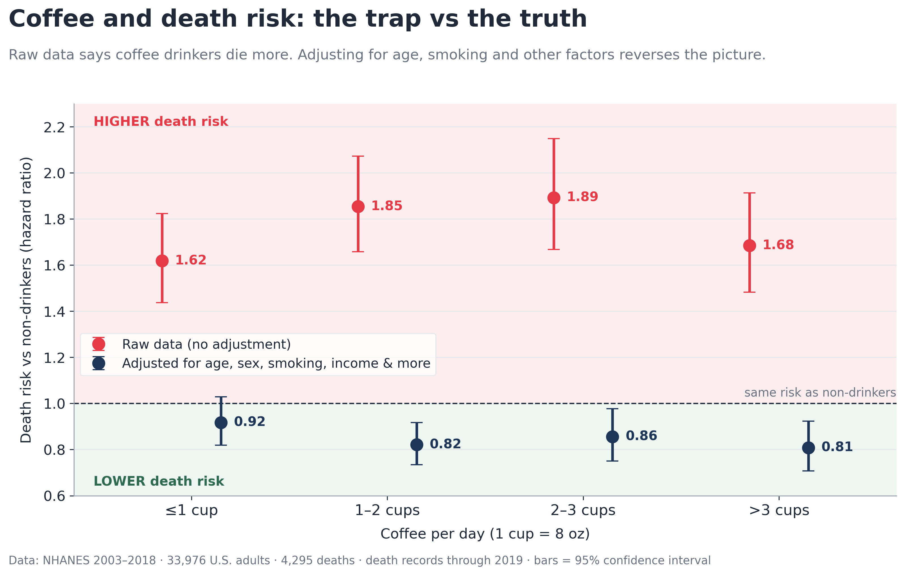
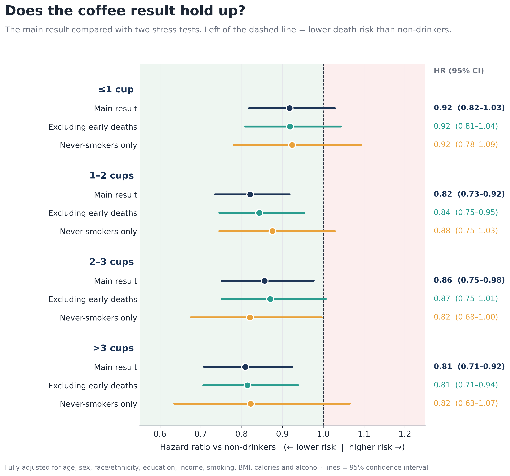

# ☕ Does Coffee Add Years to Your Life? What Public Data Says

> **In the raw data, coffee drinkers die *more* often.**
> **After accounting for age, smoking and other factors, the picture flips:**
> **drinking 1+ cups a day is linked to 14–19% lower risk of death.**

An end-to-end analysis of **33,976 U.S. adults** followed for a median of **8 years**,
using only free public data from the CDC, with open Python code and automated
validation checks ("gates") at every step.



---

## Key findings

| Coffee per day | Raw data (no adjustment) | Fully adjusted | Interpretation |
|---|---|---|---|
| None | 1.00 (reference) | 1.00 (reference) | — |
| ≤1 cup | 1.62 (1.44–1.82) | 0.92 (0.82–1.03) | 8% lower, not statistically certain |
| **1–2 cups** | 1.85 (1.66–2.07) | **0.82 (0.73–0.92)** | **18% lower risk** |
| **2–3 cups** | 1.89 (1.67–2.15) | **0.86 (0.75–0.98)** | **14% lower risk** |
| **>3 cups** | 1.68 (1.48–1.91) | **0.81 (0.71–0.92)** | **19% lower risk** |

*Hazard ratios for all-cause death vs non-drinkers (95% confidence interval).
Below 1.00 = lower risk.*

**Why does the raw data mislead?** Coffee drinkers are older (median age 56 vs 41
for non-drinkers), and heavy drinkers smoke about twice as often (34% vs 19%).
Older age and smoking raise death risk on their own. Once people of the same age,
sex, smoking status and background are compared, coffee is associated with
*lower* risk.

---

## Does it hold up?



| Test | Objection it answers | Result |
|---|---|---|
| **A. Excluding deaths in the first 2 years** | "Sick people stop drinking coffee, then die soon" | Holds: HRs 0.81–0.87 for 1+ cups |
| **B. Never-smokers only** | "It's really just smoking" | Same direction (HRs 0.82–0.88), but less certain: confidence intervals touch or cross 1.00, mainly because this group has fewer deaths (1,692) |

---

## Data

| Source | What it provides |
|---|---|
| [NHANES](https://wwwn.cdc.gov/nchs/nhanes/) 2003–2018 (8 cycles) | Diet (two 24-hour recalls), demographics, smoking, measured BMI, survey design |
| [NCHS Public-Use Linked Mortality Files](https://www.cdc.gov/nchs/data-linkage/mortality-public.htm) (2019) | Death status and follow-up time through 31 Dec 2019 |

All data is free and public. Raw files are **not** stored in this repo;
`01_cleaning_coffee.ipynb` downloads them directly from the CDC.

---

## Methods

### Study flowchart

```
NHANES 2003–2018 participants                   80,312
 └─ Reliable day-1 diet recall                   69,535
     └─ Aged 20+                                 39,757   (−29,778)
         └─ Eligible for death linkage           39,682   (−75)
             └─ Not pregnant                     38,814   (−868)
                 └─ Complete confounder data     35,224   (−3,590)
                     └─ Plausible calories       33,976   (−1,248)

Final cohort: 33,976 adults · 4,295 deaths · median follow-up 8.1 years
```

### Coffee intake
- Coffee = all USDA food codes starting with **921** (101 codes: brewed, instant,
  decaf, espresso, lattes, iced and frozen drinks).
- **Excluded:** 10 dry-powder / concentrate codes weighed before water was added
  (median 0.9–12.8 g; 300 of 54,458 records).
- **1 cup = 8 fl oz = 236.6 g.** Two reliable recall days were averaged; otherwise day 1 was used.
- Groups: 0, ≤1, 1–2, 2–3, >3 cups/day.

### Outcome
All-cause death. Follow-up starts at the exam visit (when diet was recorded) and
ends at death or 31 Dec 2019.

### Statistical analysis
- **Cox proportional hazards models**, three levels of adjustment:
  1. Crude (coffee only)
  2. Age + sex
  3. Fully adjusted: age, sex, race/ethnicity, education, income-to-poverty ratio,
     smoking (never/former/current), measured BMI, calories, alcohol
- **Survey weights** (dietary day-1 weight ÷ 8 cycles) with robust standard errors
  clustered on the NHANES design (cycle × strata × PSU).
- **Implausible diets excluded** using the Willett rule (women 500–3,500 kcal/day,
  men 800–4,200 kcal/day).

### Population characteristics (survey-weighted)

| | None | ≤1 cup | 1–2 cups | 2–3 cups | >3 cups |
|---|---|---|---|---|---|
| People | 13,814 | 5,362 | 7,313 | 3,856 | 3,631 |
| Deaths | 1,230 | 697 | 1,143 | 631 | 594 |
| Age, mean | 42.1 | 47.7 | 51.5 | 52.8 | 52.8 |
| Current smoker, % | 18.9 | 17.4 | 17.9 | 20.3 | 34.3 |
| NH White, % | 62.2 | 54.4 | 70.7 | 81.8 | 88.4 |
| Alcohol g/day, mean | 7.9 | 7.7 | 9.5 | 12.0 | 11.5 |

Full table: [`results/table1_characteristics.csv`](results/table1_characteristics.csv)

---

## Quality control: the "gates"

Every step contains automatic checks that **stop the notebook** if anything fails.
Examples:

- Every downloaded file is verified as a genuine data file, not an error page
- Death-record IDs match the demographic files **exactly**, cycle by cycle
- Each person's coffee intake was **recomputed directly from the raw food files**
  for random participants and matched to the gram
- Every recoded category reconciles with the original survey codes
- Death counts are re-checked against the raw death file after every filter
- **Positive controls:** in every model, age and smoking must raise death risk
  (they do: age HR 1.10 per year, current smoking HR 2.24)
- Every number in the figures is read back from saved results and must match

### Issues the gates caught
| Issue | What happened | Fix |
|---|---|---|
| Fixed-width death files | Lines had different lengths | CDC trims trailing spaces; verified layout with example lines |
| Follow-up slightly over the possible window | 1.3% of people, 1–5 months | Inclusive month counting and CDC privacy noise; 6-month tolerance, values kept as published |
| "Cappuccino" not matching "coffee" | Coffee drinks named without the word | Gate checks a list of coffee drink names |
| **Hidden "fake zeros"** | Pandas read 118,116 true zeros from SAS files as ~5e-79 | Converted back to exact zeros; new gate ensures none remain |

---

## Limitations

- **Observational data:** this shows an *association*, not proof that coffee
  causes longer life. People who drink coffee may differ in ways not measured.
- **Physical activity is not included**, because NHANES changed its activity
  questions in 2007, so the measure isn't comparable across all cycles.
- **Diet is measured on 1–2 days**, which may not reflect long-term habits.
- **Cups are measured by volume:** an espresso (~90 g) counts as ~0.4 cups and the
  milk in a latte counts toward volume (<3% of records).
- **Public-use death files** include small privacy-protecting changes to follow-up time.
- Ages are top-coded at 80 or 85 by NHANES.

### How this compares
A [Tufts University study](https://now.tufts.edu/2025/06/16/hold-cream-and-sugar-black-coffee-linked-lower-risk-death)
using NHANES 1999–2018 reported about 16% lower all-cause mortality with at least
one cup a day. This independent analysis finds a similar 14–19%.

---

## Reproduce it

1. Open `notebooks/01_cleaning_coffee.ipynb` in Google Colab and run all cells.
   It downloads the raw data (~1 GB) to your Google Drive and builds the cohort.
2. Open `notebooks/02_analysis_coffee.ipynb` and run all cells.

Requirements: Python 3, `pandas`, `numpy`, `lifelines`, `matplotlib`, `pyarrow`.

## Repository structure

```
├── README.md
├── notebooks/
│   ├── 01_cleaning_coffee.ipynb    # download, verify, clean, build cohort
│   └── 02_analysis_coffee.ipynb    # Table 1, Cox models, sensitivity, figures
├── figures/
│   ├── fig1_trap_vs_truth.png
│   └── fig2_forest_plot.png
└── results/
    ├── table1_characteristics.csv
    ├── cox_results.csv
    └── sensitivity_results.csv
```

---

## Author

**Muhammad Ali**, Doctor of Physical Therapy · healthcare data & real-world evidence

*Part of a series testing popular health claims with public data.*
